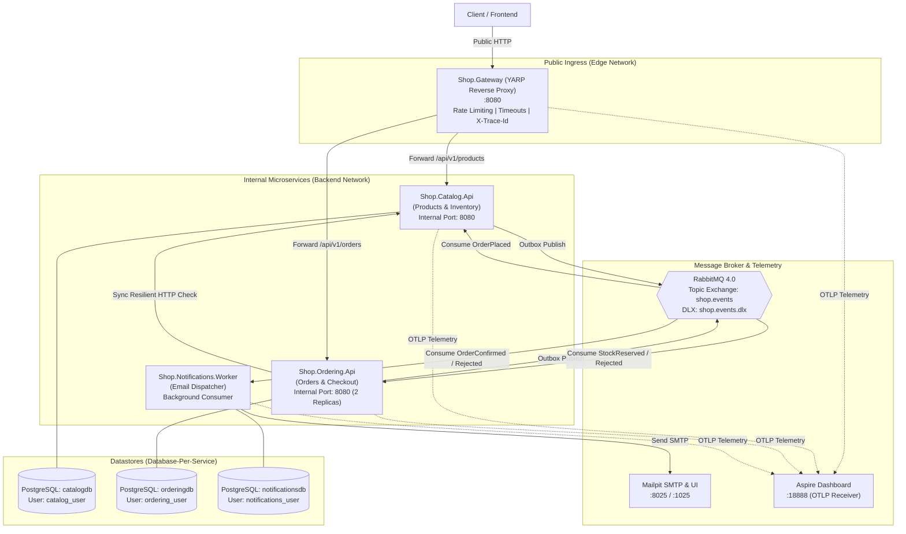
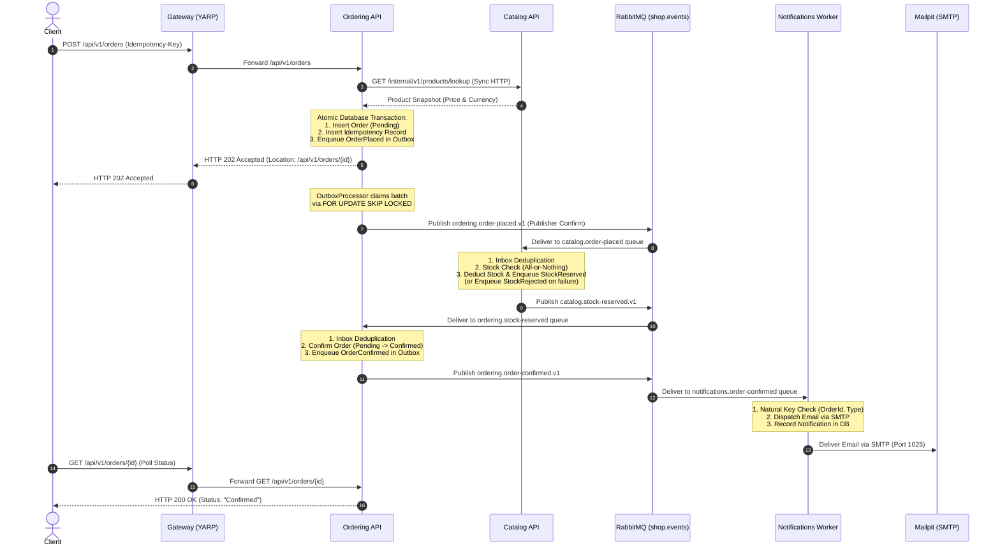

# MicroservicesShop: Reference Microservices Architecture in .NET 10 & C# 14

A production-grade, interview-ready reference implementation of a distributed microservices architecture built on **.NET 10 (`net10.0`, LTS)** and **C# 14**.

This repository demonstrates the core patterns of modern distributed systems without third-party framework magic: Database-per-Service, Transactional Outbox, Transactional Inbox, Idempotent Consumers, Choreographed Saga with Compensation, Resilient HTTP, End-to-End Distributed Tracing (W3C), and a Reverse Proxy Gateway.

---

## 1. Architecture Overview



---

## 2. The Choreographed Saga Workflow

The checkout workflow transitions from synchronous validation to asynchronous event choreography:



---

## 3. Microservices & Responsibilities

| Service | Technology | Port / Endpoint | Datastore & Role | Primary Responsibilities |
| :--- | :--- | :--- | :--- | :--- |
| **`gateway`** | YARP Reverse Proxy | `:8080` (Public) | None | Single external entry point; rate limiting (10 req/10s per IP); request timeouts (30s); stamps `X-Trace-Id`; blocks internal routes. |
| **`catalog-api`** | ASP.NET Core Minimal API | Internal `:8080` | `catalogdb`<br/>(`catalog_user`) | Owns products and inventory; concurrency token `Version`; internal bulk lookup endpoint; consumes `OrderPlaced` for all-or-nothing stock reservation. |
| **`ordering-api`** | ASP.NET Core Minimal API | Internal `:8080`<br/>(2 Replicas) | `orderingdb`<br/>(`ordering_user`) | Owns orders and state machine (`Pending`, `Confirmed`, `Rejected`); resilient `CatalogClient`; HTTP idempotency; transactional outbox and saga consumers. |
| **`notifications-worker`** | ASP.NET Core Web SDK | Internal `:8080` | `notificationsdb`<br/>(`notifications_user`) | Background event consumer; natural key deduplication; dispatches confirmation and rejection emails via Mailpit SMTP. |

---

## 4. Failure Modes & Defensive Mechanisms

| Scenario / Failure Mode | Root Cause / Risk | Defensive Mechanism | System Result |
| :--- | :--- | :--- | :--- |
| **Network Hiccup on Product Lookup** | Transient socket reset or pod restart. | `Microsoft.Extensions.Http.Resilience`: 3 retries with exponential backoff and jitter. | Request succeeds transparently on retry without client error. |
| **Catalog API Down Hard** | Service outage or repeated 500 errors. | Polly Circuit Breaker (50% failure ratio over 10s, breaks for 15s). | Fails fast with HTTP 503 (`Ordering.CatalogUnavailable`) and `Retry-After: 15`. No dirty pending order created. |
| **Client Retries Checkout POST** | Network dropped client connection before 202 response arrived. | Database-backed idempotency table with request payload SHA-256 fingerprinting. | Cached 202 response replayed with `Idempotent-Replayed: true`. No duplicate order created. |
| **Process Crashes Mid-Checkout** | Power loss after order creation but before message broker publish. | Transactional Outbox commits event in same local PostgreSQL transaction as the order. | Outbox message committed safely; background processor publishes upon restart. |
| **Horizontal Replicas Poll Outbox** | Multiple pods competing for outbox table causing lock stalls or duplicate publishes. | PostgreSQL `FOR UPDATE SKIP LOCKED`. | Each worker locks a non-overlapping batch without waiting; zero lock contention. |
| **RabbitMQ Redelivers Message** | At-least-once broker delivery re-sends already processed event. | Transactional Inbox with `INSERT ... ON CONFLICT DO NOTHING` on `(message_id, handler_name)`. | Duplicate detected; acknowledged immediately without re-executing handler. |
| **Saga Replay / Regenerated Event** | Upstream service re-runs a workflow with a new `MessageId`. | Natural Key Deduplication in Notifications on `(order_id, notification_type)`. | Customer receives exactly one confirmation or cancellation email per order. |
| **Poison / Malformed Message** | Corrupted JSON or unhandled bug exhausts in-process retries. | Dead-Letter Exchange (`shop.events.dlx`) and DLQ (`<queue>.dlq`). Consumer rejects with `requeue: false`. | Poison message moved to DLQ; main queue continues processing healthy messages. |

---

## 5. Architectural Decision Records (ADRs)

| ADR | Title | Decision Summary |
| :--- | :--- | :--- |
| [ADR 0001](docs/adr/0001-service-boundaries-and-database-per-service.md) | Service Boundaries & Database Per Service | Strict database isolation with dedicated PostgreSQL login roles. |
| [ADR 0002](docs/adr/0002-synchronous-versus-asynchronous-communication.md) | Synchronous vs. Asynchronous Communication | Synchronous HTTP only for immediate validation; events for all side effects. |
| [ADR 0003](docs/adr/0003-choreographed-saga-pattern.md) | Choreographed Saga Pattern | Decentralized choreography with compensation by terminal state rejection. |
| [ADR 0004](docs/adr/0004-rabbitmq-exchange-and-queue-topology.md) | RabbitMQ Exchange & Queue Topology | Topic exchange `shop.events`, dead-letter exchange `shop.events.dlx`, and DLQs. |
| [ADR 0005](docs/adr/0005-hand-written-outbox-and-inbox-patterns.md) | Hand-Written Outbox and Inbox Patterns | Hand-crafted on official `RabbitMQ.Client` 7.x async API without third-party frameworks. |
| [ADR 0006](docs/adr/0006-skip-locked-outbox-claiming.md) | SKIP LOCKED Outbox Claiming | Lock-free concurrent batch claiming using PostgreSQL `FOR UPDATE SKIP LOCKED`. |
| [ADR 0007](docs/adr/0007-yarp-api-gateway.md) | YARP API Gateway | Sole public ingress; rate limiting, timeouts, and route blocking. |
| [ADR 0008](docs/adr/0008-resilience-policy-parameters.md) | Resilience Policy Parameters | Exponential backoff, jitter, attempt timeouts, and circuit breaking. |
| [ADR 0009](docs/adr/0009-idempotency-strategy.md) | Idempotency Strategy | Header-based idempotency key with request body SHA-256 fingerprinting. |
| [ADR 0010](docs/adr/0010-contracts-and-event-versioning.md) | Contracts & Event Versioning | Pure, zero-dependency contract records with versioned routing keys. |
| [ADR 0011](docs/adr/0011-asynchronous-messaging-technology.md) | Asynchronous Messaging Technology | RabbitMQ 4.x for topic routing, publisher confirms, and dead-lettering. |
| [ADR 0012](docs/adr/0012-distributed-tracing-and-w3c-trace-context.md) | Distributed Tracing & W3C Trace Context | Trace propagation across outbox and broker boundaries via OpenTelemetry. |
| [ADR 0013](docs/adr/0013-observability-stack.md) | Observability Stack | OpenTelemetry protocol (OTLP) exporting to .NET Aspire Dashboard. |
| [ADR 0014](docs/adr/0014-internal-and-health-endpoints.md) | Internal & Health Endpoints | Separation of public endpoints, internal lookups, and container health probes. |
| [ADR 0015](docs/adr/0015-authentication-and-authorization-boundaries.md) | Authentication & Authorization Boundaries | Edge JWT validation at Gateway with claim propagation downstream. |
| [ADR 0016](docs/adr/0016-notifications-natural-key-vs-inbox.md) | Natural Key Deduplication vs. Inbox | Domain-level deduplication on `(order_id, type)` for irreversible side effects. |
| [ADR 0017](docs/adr/0017-concurrency-token-strategy.md) | Concurrency Token Strategy | Application-managed integer `Version` concurrency token avoiding xmin conflicts. |

---

## 6. Getting Started

### Local Development with .NET Aspire
```bash
# Start all microservices, databases, RabbitMQ, and Mailpit
dotnet run --project src/Shop.AppHost
```

### Production-like Run with Docker Compose
```bash
# 1. Build and run containers
docker compose up -d --build

# 2. Run automated end-to-end smoke test
bash scripts/smoke-test.sh

# 3. Stop containers and clean volumes
docker compose down -v
```

### Running Tests
```bash
# Run all unit, architecture, and integration tests
dotnet test Shop.slnx -c Release --filter "Category!=E2E"

# Verify formatting and coding standards
dotnet format --verify-no-changes
```

---

## 7. Documentation & Resources

- [Operational Runbook](docs/RUNBOOK.md)
- [Technical Interview Notes](docs/INTERVIEW-NOTES.md)
- [AsyncAPI 3.0 Specification](docs/asyncapi.yaml)
- [HTTP Request Collection](requests/)
